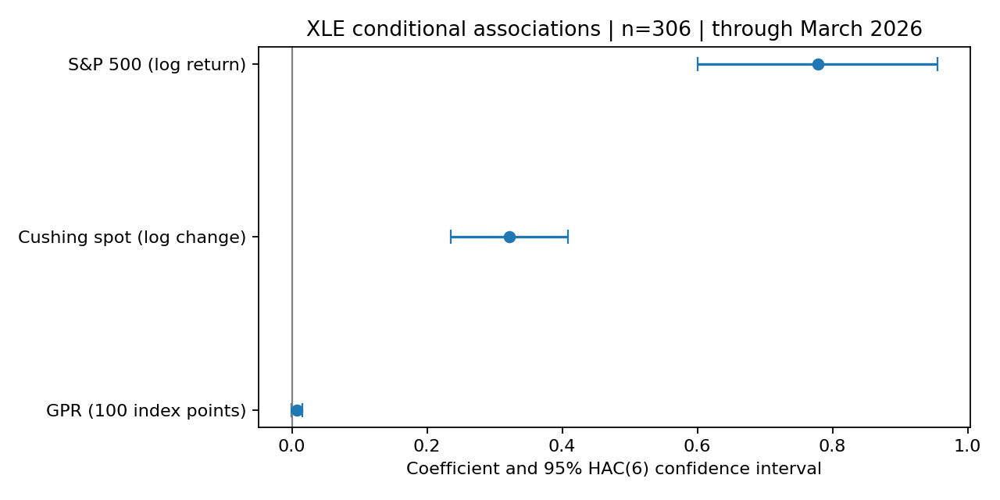

# Energy markets and geopolitical risk

**Version 2.0.0 | November 11, 2026.** [Final report](docs/RELEASE_V2.md) | [Validation](docs/CLEAN_VALIDATION.json) | [Final review](docs/FINAL_RED_TEAM.md). PR #1 was merged as a retrospective exploratory study. Oil exposure is positive across the reported checks; full-model instability and residual dependence remain. [Release assets and limitations](https://github.com/jasonrkeen/energy-markets-geopolitical-risk-study/releases/tag/v2.0.0).

XLE had an estimated Cushing WTI spot-price exposure of **0.322** over 306 completed months from October 2000 through March 2026. A 1% higher monthly spot-price change was associated with approximately 0.32% higher XLE return, conditional on S&P 500 return and publisher monthly GPR. The 95% HAC interval was 0.235 to 0.408. The matched CL=F sensitivity gave 0.321. The GPR coefficient had p=0.089. These are retrospective associations.

[Current findings, source reconciliation and methodological limits](docs/SPOT_GPR_RECONCILIATION.md) · [Source manifest](outputs/v2/manifest.json) · [Matched results](outputs/v2/matched_proxy_comparisons.csv)



## Reproduce

Use Python 3.14 in a virtual environment at the repository root.

```sh
python -m pip install -r requirements-lock.txt
python main.py --fetch --verify-repeat
python -m pytest -q
```

The initial fetch caches the daily Yahoo market fields, EIA RWTC workbook and archived publisher GPR workbooks. Use `python main.py --verify-repeat` for offline runs with those caches. The EIA and Yahoo histories can revise. See the current report for acquisition details and original-vintage limits.

## Historical material

The original notebook is preserved and replayed in isolation. The October draft used CL=F and a daily-average GPR index as its primary inputs. Its review records are retained for comparison. [V1 README](docs/v1/README.md) · [October methodology](docs/METHODOLOGY_V2.md) · [October review](docs/PR1_REVIEW.md)

## Data redistribution

The v2.0.0 attached ZIP is distribution revision 2: licensed GPR snapshots are included; Yahoo data and the unresolved EIA/Refinitiv cache are withheld. Some row-level outputs and V1 evidence are omitted, so the ZIP is a partial reproduction kit. The existing Git history and generated source archives have separate unresolved data exposure. Read the [permissions review](docs/DATA_REDISTRIBUTION.md) and [attribution](docs/DATA_ATTRIBUTION.md) before sharing data.
