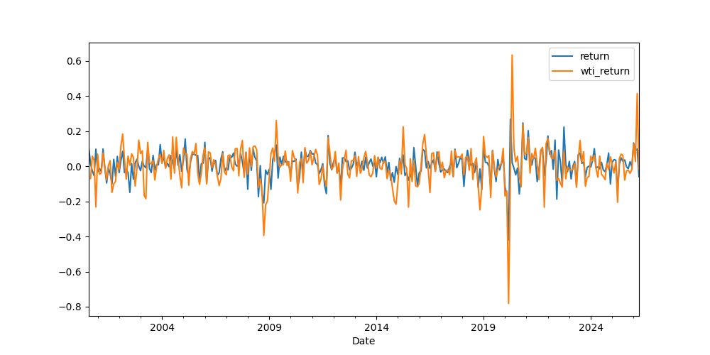
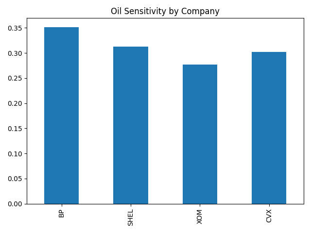

# Energy Markets & Geopolitical Risk

## Overview

This project investigates whether **geopolitical risk impacts energy equity returns**, using:

- **XLE (Energy Select Sector SPDR Fund)** for sector-level analysis
- **BP, Shell, Exxon Mobil, and Chevron** for firm-level analysis

The central question:

> Do energy stocks respond directly to geopolitical risk, or indirectly through oil prices?

---

## TL;DR

- Geopolitical risk does **not directly impact** energy equity returns  
- Oil prices and market returns are the **primary drivers**  
- Geopolitical events affect energy stocks **indirectly through oil markets**

---

## 🧠 Key Finding

> **Geopolitical risk is not a statistically significant direct driver of energy equity returns.  
Instead, its impact is transmitted through oil prices.**

```text
Geopolitical Risk → Oil Prices → Energy Equities
```

---

## Why This Matters

Energy markets are widely assumed to react directly to geopolitical events.  
This analysis challenges that assumption.

- Geopolitical risk is not statistically significant as a direct predictor of XLE returns
- Oil returns and broad market returns are the strongest explanatory variables
- Energy equities respond to geopolitical shocks mainly through commodity price movements

---

## Data Sources

- XLE, BP, Shell, Exxon Mobil, Chevron, WTI futures, and S&P 500 data: `yfinance`
- Geopolitical Risk Index: Caldara & Iacoviello  
  https://www.matteoiacoviello.com/gpr.htm
- U.S. Energy Information Administration Short-Term Energy Outlook  
  https://www.eia.gov/outlooks/steo/report/global_oil.php
- International Energy Agency Oil Market Report  
  https://www.iea.org/reports/oil-market-report-april-2026
- OPEC Monthly Oil Market Report  
  https://www.opec.org/assets/assetdb/momr-march-2026.pdf

---

## Geopolitical Risk Measure

This project uses the **Geopolitical Risk (GPR) Index** developed by Dario Caldara and Matteo Iacoviello.

The index is based on text analysis of major newspapers and measures the share of news coverage related to geopolitical risk.

---

## Methodology

The analysis follows four steps:

1. Convert daily financial data to monthly frequency  
2. Compute monthly log returns  
3. Estimate OLS regressions using geopolitical risk, oil returns, and market returns  
4. Extend the analysis using firm-level regressions, event study comparisons, and scenario forecasting  

Core model:

```python
X = sm.add_constant(df[["gpr", "wti_return", "sp500_return"]])
y = df["return"]

model = sm.OLS(y, X).fit()
```

---

## Results

### Sector-Level Results: XLE

- **WTI returns:** highly significant  
- **S&P 500 returns:** highly significant  
- **Geopolitical risk:** not statistically significant  

R² ≈ 0.57

This implies that energy equities behave as a combination of:
- **market beta (broad equity exposure)**
- **commodity beta (oil price exposure)**

---

## Visual Evidence





---

## Firm-Level Analysis

| Company | Oil Sensitivity |
|--------|-----------------|
| BP | ~0.35 |
| Shell | ~0.31 |
| Chevron | ~0.30 |
| Exxon | ~0.28 |

---

## Event Study

| Period | Average Monthly XLE Return |
|--------|-----------------------------|
| Normal GPR periods | ~0.0067 |
| High GPR periods | ~0.0062 |

---

## Correlation Analysis

| Variable Pair | Correlation |
|--------------|-------------|
| XLE returns vs WTI returns | ~0.62 |
| XLE returns vs GPR | ~0.00 |

---

## Scenario Forecasting

| Scenario | WTI (%) | S&P 500 (%) | Forecast XLE Return (%) |
|---------|---------|-------------|--------------------------|
| Bear Case | -10 | -5 | -6.8 |
| Base Case | 0 | 1 | 0.8 |
| Bull Case | 8 | 4 | 5.7 |
| Oil Shock | 15 | -2 | 3.8 |
| Market Selloff | -5 | -10 | -8.8 |

This framework provides a simple way to translate macro assumptions into expected sector performance.

---

## Final Takeaway

Across multiple approaches—including regression analysis, firm-level modeling, event studies, correlation analysis, and scenario forecasting—the results are consistent:

- Geopolitical risk is not a statistically significant direct driver of energy equity returns  
- Oil prices act as the primary transmission channel  
- Market conditions remain the dominant factor  

This suggests that financial markets incorporate geopolitical information indirectly through commodity prices rather than pricing geopolitical risk directly into equities.

---

## Tech Stack

- Python  
- pandas  
- numpy  
- statsmodels  
- matplotlib  
- yfinance  

---

## How to Run

### 🔧 Setup Environment

```bash
python -m venv .venv
```

Activate:

```bash
.venv\Scripts\activate
```

Install dependencies:

```bash
pip install -r requirements.txt
```

---

## 📌 Notes

- Charts are saved in:
```text
outputs/charts/
```

- Run the full analysis:
```text
notebooks/analysis.ipynb
```

---

## Author

Jason Keen
