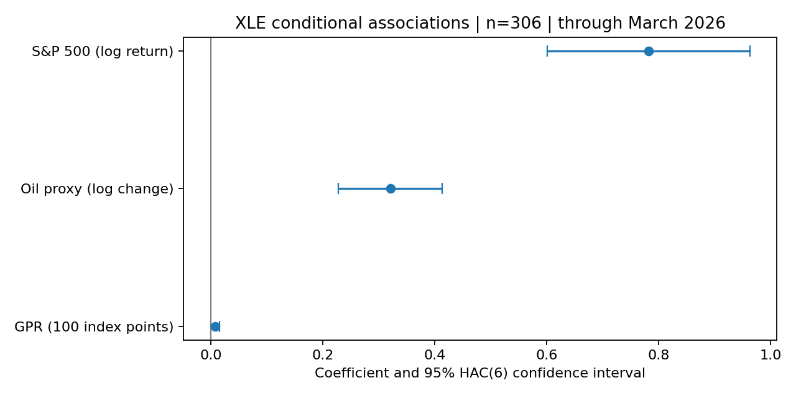

# Energy Markets and Geopolitical Risk — Version 2 research review

Retrospective monthly association study of XLE, a WTI futures price proxy, S&P 500 price returns and the Caldara–Iacoviello daily GPR index. **Exploratory results; no causal mediation or validated forecasting claim.**

## Verified results

The archived 33-cell Version 1 notebook was replayed with a dated current-vintage market cache: 308 observations, R² 0.5751, oil coefficient 0.3230 and market coefficient 0.7518. This closely matches saved results but is not exact original-vintage reproduction. Original daily downloads and dependency versions were not retained.

Version 1 included partial April 2026 observations. Version 2 excludes that month and uses explicit adjustment conventions, calendar-month lags, matched samples and robust uncertainty estimates. On the common October 2000–March 2026 sample (306 observations):

| Term | Coefficient | 95% HAC(6) interval | p-value |
|---|---:|---:|---:|
| Oil proxy log change | 0.3208 | 0.2283 to 0.4134 | <0.001 |
| S&P 500 log return | 0.7822 | 0.6011 to 0.9633 | <0.001 |
| GPR per 100 index points | 0.00770 | −0.00043 to 0.01582 | 0.063 |

R² = 0.5892. GPR inference varies across specifications and covariance choices. The controlled contemporaneous GPR–oil p-value is 0.840; none of the eleven joint GPR tests rejects at 5% after Holm adjustment. This neither establishes a zero GPR effect nor supports an oil-transmission mechanism. Results are retrospective and sensitive to proxy, sample and model choices.



## Reproduce

Use Python 3.14 in a virtual environment, from repository root:

```sh
python -m pip install -r requirements-lock.txt
python main.py --fetch
python -m pytest -q
python main.py --verify-repeat
```

The first command sequence downloads market inputs once; subsequent pipeline runs use the checksum-verified local cache. A fresh download may contain vendor revisions. Raw new downloads are ignored by Git. Exact same-vintage reproduction requires the retained local cache. `requirements.txt` lists direct pins; `requirements-lock.txt` records the tested clean environment, including transitive packages. The optional notebook interface is in `requirements-notebook.txt`.

## Review material

[October 26 PR review and remaining blockers](docs/PR1_REVIEW.md): cache contracts, frozen input checks, stale endpoint rejection, fixed-sample enforcement, calendar-HAC crisis sensitivity and staged output publication have been added. The primary sample and coefficients are unchanged.

- [Short findings and red-team report](docs/FINDINGS_V2.md)
- [Methods, source references and reproduction boundaries](docs/METHODOLOGY_V2.md)
- [Validation scope and evidence](docs/VALIDATION.md)
- [Coefficient table](outputs/v2/coefficients.csv), [joint GPR tests](outputs/v2/joint_gpr_tests.csv), [source manifest](outputs/v2/manifest.json)
- [Original README, retained as historical evidence](docs/v1/README.md)

The original notebook, retained data and three V1 outputs are unchanged. Do not execute the old notebook in place to reproduce this review: it fetches unbounded current data and overwrites original outputs. The new pipeline executes its code in an isolated replay directory.

Scenario outputs are conditional illustrations with correct simple/log conversions, not investment forecasts. CL=F is a stitched futures price proxy without a documented investment-roll strategy; ^GSPC excludes dividends. The retained GPR workbook ends April 27, 2026 and has no historical download receipt. See the methodology before interpreting results.

Author: Jason Keen
